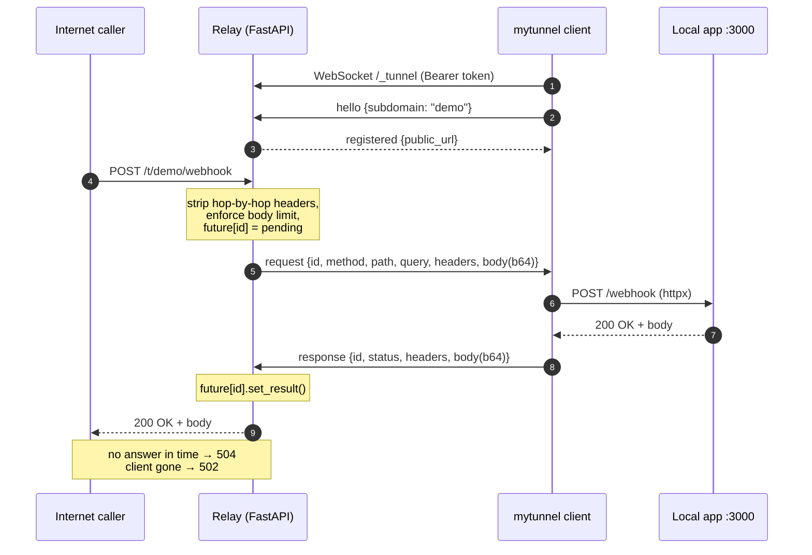

# mytunnel

**A self-hosted, ngrok-style HTTP tunnel in Python.** Run a small FastAPI relay on any
server with a public IP, then expose `localhost:3000` from your laptop with one command —
all traffic is multiplexed over a single authenticated WebSocket.

[](https://github.com/samandar-hamrayev/my-tunnel/actions/workflows/ci.yml)

[](LICENSE)

```console
$ mytunnel http 3000 --server wss://tunnel.example.com --token $MYTUNNEL_TOKEN --subdomain demo
Forwarding https://tunnel.example.com/t/demo/ -> http://127.0.0.1:3000
12:45:11 INFO    mytunnel.client: POST /webhooks/payme -> 200 (25 ms)
```

<!-- Demo: add a short terminal recording here (e.g. docs/demo.gif) once recorded. -->

## Why

Payment providers, Telegram bots and OAuth flows all need to call *your* HTTP endpoint,
which is awkward while it still runs on `localhost`. Hosted tunnels solve this, but come
with rate limits, random URLs and a third party in the middle of your webhook traffic.

`mytunnel` is the small, readable version you can run yourself: one relay process, one
client process, no database, no broker. It is also a compact example of the async
patterns behind real reverse proxies — request multiplexing, correlation by id,
timeouts, back-pressure and reconnection.

## How it works

1. The client opens a WebSocket to the relay (`/_tunnel`) with `Authorization: Bearer <token>`
   and asks for a name (`demo`). The relay replies with the public URL.
2. A public HTTP request to `/t/demo/...` (or `demo.<domain>` in subdomain mode) is
   serialized — method, path, query, headers, base64 body and a fresh request id — and sent
   down the socket. The relay parks an `asyncio.Future` under that id.
3. The client forwards it to the local app with `httpx.AsyncClient` and sends back a
   response frame carrying the same id.
4. The relay resolves the future and answers the original HTTP caller. Many requests
   are in flight at the same time over the same socket.



## Design decisions

| Decision | Why |
| --- | --- |
| **One persistent WebSocket per client** | Outbound connection from the laptop, so it works behind NAT and firewalls; no polling latency; one TLS handshake instead of one per request. |
| **Multiplexing by request id + `asyncio.Future`** | Requests do not block each other. The relay keeps a `dict[id, Future]`; the socket reader resolves futures as responses arrive, in any order. |
| **Timeout via `asyncio.timeout` around the future** | A slow or stuck local app yields a clean `504` and the pending entry is always removed (`finally`), so nothing leaks. |
| **Fail all pending futures on disconnect** | When a client drops, every waiting caller immediately gets `502` instead of hanging until the timeout. |
| **No Redis** | The original version queued requests through Redis lists. A tunnel is bound to one live socket on one relay process, so the state is inherently in-memory; Redis added a network hop, a dependency and a polling loop without enabling anything. Horizontal scaling would need sticky routing first (see Roadmap). |
| **JSON frames validated by pydantic (discriminated union)** | Self-describing, easy to debug with any WebSocket tool, and malformed frames are rejected at the boundary. Base64 costs ~33% on bodies — acceptable for webhooks and APIs; binary frames are on the roadmap. |
| **Raw upstream bytes (`aiter_raw`)** | The client does not decompress responses, so `Content-Encoding: gzip` and the body stay consistent end to end. |
| **Header lists, not dicts** | Duplicate headers such as multiple `Set-Cookie` survive the round trip. |
| **Exponential backoff with jitter on reconnect** | A relay restart does not cause a thundering herd of clients reconnecting at the same instant. |
| **Constant-time token comparison, checked before `accept()`** | Bad tokens never get a WebSocket; the handshake is answered with HTTP 403. `hmac.compare_digest` avoids timing leaks. |

## Features

- `mytunnel http <port>` client and `mytunnel server` relay, installed as one console script
- Path-prefix routing (`/t/<name>/...`) out of the box, optional subdomain routing (`<name>.<domain>`)
- Named or random tunnel names; name collisions are rejected
- Concurrent requests over a single socket
- Status codes: `404` unknown tunnel, `413` body too large, `502` client disconnected / local app down,
  `503` too many in-flight requests on a tunnel, `504` timeout
- Hop-by-hop header stripping (RFC 9110 §7.6.1, including headers named in `Connection`),
  `X-Forwarded-For/-Proto/-Host` added by the relay (spoofed values are replaced)
- Request and response body size limits, WebSocket frame size limit derived from them
- Client: reconnect with backoff, graceful shutdown on Ctrl+C / SIGTERM (drains in-flight requests)
- Relay: `/healthz`, settings via environment / `.env` (pydantic-settings), Docker image (non-root, healthcheck)

## Quick start

### 1. Run the relay (Docker)

```bash
git clone https://github.com/samandar-hamrayev/my-tunnel.git && cd my-tunnel
cp .env.example .env
# put a real token into MYTUNNEL_TOKENS, e.g.:
python -c "import secrets; print(secrets.token_urlsafe(32))"
docker compose up -d --build
curl http://127.0.0.1:8080/healthz   # {"status":"ok","version":"0.2.0","tunnels":0}
```

Or without Docker: `pip install . && MYTUNNEL_TOKENS=... mytunnel server`.

### 2. Expose a local app

```bash
pip install git+https://github.com/samandar-hamrayev/my-tunnel.git
export MYTUNNEL_TOKEN=...            # one of the relay's MYTUNNEL_TOKENS
mytunnel http 3000 --server ws://127.0.0.1:8080 --subdomain demo
curl http://127.0.0.1:8080/t/demo/   # served by your app on :3000
```

Want something to tunnel right away? `docker compose --profile demo up -d` also starts a
tiny echo app on `127.0.0.1:9000`; run `mytunnel http 9000 ...` and curl the tunnel.

### CLI

```text
mytunnel http PORT [--server URL] [--token TOKEN] [--subdomain NAME] [--host 127.0.0.1]
                   [--timeout 30] [--log-level info]
mytunnel server    [--host HOST] [--port PORT]
mytunnel --version
```

`--server` accepts `ws://`, `wss://`, `http://` or `https://`; `/_tunnel` is appended
automatically. `--server`, `--token` and `--log-level` can also come from
`MYTUNNEL_SERVER`, `MYTUNNEL_TOKEN` and `MYTUNNEL_LOG_LEVEL`.

## Configuration (relay)

All settings are environment variables (or a `.env` file in the working directory).

| Variable | Default | Description |
| --- | --- | --- |
| `MYTUNNEL_TOKENS` | — (required) | Comma-separated accepted client tokens. The relay refuses to start without one. |
| `MYTUNNEL_HOST` / `MYTUNNEL_PORT` | `0.0.0.0` / `8080` | Bind address. |
| `MYTUNNEL_DOMAIN` | unset | Enables subdomain routing: `<name>.<domain>` → tunnel `<name>`. Needs wildcard DNS. |
| `MYTUNNEL_PUBLIC_URL` | derived from request | Base URL reported to clients, e.g. `https://tunnel.example.com`. |
| `MYTUNNEL_REQUEST_TIMEOUT` | `30` | Seconds to wait for a client's response before `504`. |
| `MYTUNNEL_HANDSHAKE_TIMEOUT` | `10` | Seconds a new socket has to send `hello`. |
| `MYTUNNEL_MAX_BODY_BYTES` | `10485760` | Max request and response body size (10 MiB). |
| `MYTUNNEL_MAX_PENDING_PER_TUNNEL` | `100` | In-flight requests per tunnel before `503`. |
| `MYTUNNEL_TRUSTED_PROXIES` | `127.0.0.1` | IPs/CIDRs allowed to set `X-Forwarded-*` (your reverse proxy). |
| `MYTUNNEL_LOG_LEVEL` | `info` | Log level. |

In subdomain mode, `/healthz` and `/_tunnel` are reserved paths on every host.

## Protocol

JSON text frames on one WebSocket, each with a `type` field (protocol version `1`):

| Direction | `type` | Fields |
| --- | --- | --- |
| client → relay | `hello` | `version`, `subdomain` (optional) |
| relay → client | `registered` | `tunnel`, `public_url` |
| relay → client | `error` | `code` (`name_taken`, `invalid_name`, `unsupported_version`, `bad_handshake`), `message` — followed by close |
| relay → client | `request` | `id`, `method`, `path`, `query`, `headers` (list of `[name, value]`), `body` (base64) |
| client → relay | `response` | `id`, `status`, `headers`, `body` (base64) |

Authentication happens in the WebSocket handshake (`Authorization: Bearer <token>`); a bad
token gets HTTP 403 and never reaches the frame protocol. Liveness is handled by WebSocket
ping/pong (enabled on both sides), so half-open connections are detected and closed.
Application close codes: `4400` bad handshake, `4409` name taken; `1001` when the relay shuts down.

```json
{"type":"request","id":"9f1c…","method":"POST","path":"/webhook","query":"a=1",
 "headers":[["content-type","application/json"]],"body":"eyJvayI6dHJ1ZX0="}
```

## Security notes

- **TLS is not terminated by mytunnel.** Run the relay behind Caddy, Nginx or Traefik with
  HTTPS and WebSocket upgrade enabled, have clients use `wss://`, and set
  `MYTUNNEL_TRUSTED_PROXIES` to the proxy's address so client IPs are reported correctly.
  Without TLS, tokens and traffic travel in clear text.
- Tokens are shared secrets (no per-user accounts, no expiry). Rotate by editing
  `MYTUNNEL_TOKENS` and restarting. Any valid token can claim any free name.
- Bodies are buffered in memory and capped by `MYTUNNEL_MAX_BODY_BYTES`; in-flight requests
  are capped per tunnel. There is **no** rate limiting or per-IP throttling — add it at the
  reverse proxy if the relay is public.
- Only plain HTTP request/response is tunneled: no WebSockets, Server-Sent Events, or
  streaming responses through the tunnel.
- The Docker image runs as an unprivileged user; compose adds `read_only`, `cap_drop: ALL`
  and `no-new-privileges`.

## Testing

```bash
make install   # venv + editable install with dev extras
make lint      # ruff check + ruff format --check
make cov       # pytest with coverage
```

The suite (58 tests, ~91% coverage) runs real uvicorn servers on ephemeral ports inside
the test event loop: a relay, a tiny local FastAPI app and a real client. It covers the
protocol codec, GET/POST with binary bodies, header and status passthrough, duplicate
`Set-Cookie`, hop-by-hop stripping, **20 concurrent requests that only complete if they
are truly multiplexed** (an `asyncio.Barrier` in the local app), `504` timeout, `502` on
client disconnect and on a dead local app, `404`, `413`, `503`, bad token, name conflicts,
handshake errors, reconnect after a relay drop, graceful shutdown and subdomain routing.

## Project structure

```text
src/mytunnel/
├── cli.py              # typer CLI: `mytunnel http` / `mytunnel server`
├── client.py           # TunnelClient: WebSocket session, forwarding, reconnect/backoff
├── config.py           # ServerSettings (pydantic-settings, MYTUNNEL_* env)
├── headers.py          # hop-by-hop header stripping
├── protocol.py         # pydantic message models, encode/decode, base64 bodies
└── server/
    ├── app.py          # FastAPI relay: /_tunnel WebSocket, /healthz, catch-all proxy
    └── registry.py     # Tunnel (pending futures, send lock) and TunnelRegistry
tests/                  # protocol, config, CLI and end-to-end tests
Dockerfile              # multi-stage, slim, non-root, HEALTHCHECK
docker-compose.yml      # relay (+ optional demo upstream profile)
```

## Roadmap

- Streaming bodies in chunks instead of buffering (large downloads, SSE)
- Binary WebSocket frames to drop the base64 overhead
- Tunneling WebSocket upgrades
- Per-token name reservations and rate limits
- Prometheus metrics (active tunnels, latency, status codes)
- Multi-node relay with a shared tunnel → node routing table

## License

[MIT](LICENSE) © 2026 Samandar Hamrayev
